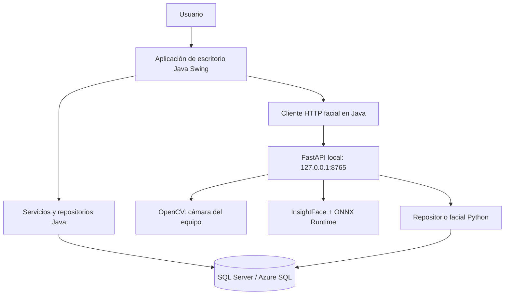

# SIGELAB

**Sistema de Gestión y Control de Laboratorios Universitarios**  
**Proyecto académico de Ingeniería en Sistemas · Programación II**

SIGELAB es una aplicación de escritorio desarrollada para apoyar la administración de laboratorios universitarios, sus usuarios y recursos tecnológicos. Integra formularios de gestión, operaciones relacionadas con inventario y préstamos, códigos QR y un servicio local de autenticación facial. La aplicación principal se implementa en **Java Swing**; el componente biométrico utiliza **Python**, **FastAPI**, **OpenCV** e **InsightFace** y se comunica con **SQL Server**.

> **Alcance de esta guía.** Esta documentación se basa en los archivos del repositorio `RomarioChajon/Proyecto-ProgramacionII`, referencia `568c8709` de `main`, revisada el 30 de octubre de 2026. La instalación puede requerir ajustes para cada equipo. No se incluyen secretos ni valores de entornos privados.

**Repositorio:** https://github.com/RomarioChajon/Proyecto-ProgramacionII

## Contenido

1. [Presentación general](#1-presentación-general)
2. [Objetivos del sistema](#2-objetivos-del-sistema)
3. [Funcionalidades principales](#3-funcionalidades-principales)
4. [Tecnologías utilizadas](#4-tecnologías-utilizadas)
5. [Arquitectura del sistema](#5-arquitectura-del-sistema)
6. [Estructura del repositorio](#6-estructura-del-repositorio)
7. [Requisitos previos](#7-requisitos-previos)
8. [Instalación y configuración](#8-instalación-y-configuración)
9. [Configuración de la base de datos](#9-configuración-de-la-base-de-datos)
10. [Módulo de reconocimiento facial](#10-módulo-de-reconocimiento-facial)
11. [Ejecución y uso](#11-ejecución-y-uso)
12. [Seguridad y protección de datos](#12-seguridad-y-protección-de-datos)
13. [Solución de problemas frecuentes](#13-solución-de-problemas-frecuentes)
14. [Control de versiones y colaboración](#14-control-de-versiones-y-colaboración)
15. [Equipo de desarrollo y créditos](#15-equipo-de-desarrollo-y-créditos)

---

## 1. Presentación general

Las instituciones universitarias administran laboratorios, equipos, usuarios y actividades que requieren registros confiables. Llevar estos procesos de forma dispersa dificulta la consulta de información, el seguimiento de recursos y el control de accesos.

**SIGELAB** reúne estas tareas en una aplicación de escritorio con interfaz gráfica. Su enfoque combina la organización de información administrativa con mecanismos de identificación, trazabilidad de operaciones y apoyo a los procesos cotidianos de laboratorio. Está concebido como un **proyecto académico**, no como una solución de seguridad biométrica certificada ni como un producto comercial auditado.

El servicio facial se ejecuta localmente y consulta la misma base de datos de SIGELAB. El uso de Azure SQL es posible cuando la conexión se configura para una instancia de SQL Server alojada en Azure; no es un requisito exclusivo de la aplicación.

## 2. Objetivos del sistema

### Objetivo general

Desarrollar un sistema informático de escritorio que centralice la gestión y el control de laboratorios universitarios, contribuya a la organización de los recursos tecnológicos e incorpore mecanismos de autenticación y consulta de información.

### Objetivos específicos

- Facilitar el mantenimiento de registros de usuarios, laboratorios, equipos, tipos de equipo y productos.
- Apoyar el seguimiento de inventario, solicitudes, préstamos, devoluciones y mantenimiento mediante formularios especializados.
- Integrar el acceso por usuario y contraseña con verificación facial según las reglas del flujo de inicio de sesión.
- Utilizar códigos QR en las funciones que los requieren para identificación o lectura de información.
- Mantener la información persistente en SQL Server y organizar el código por responsabilidades técnicas.
- Favorecer la colaboración del equipo mediante Git, ramas y revisiones de cambios.

## 3. Funcionalidades principales

Las siguientes áreas cuentan con clases, formularios o módulos identificables dentro del repositorio. La presencia de un módulo en el código no equivale, por sí sola, a una certificación de funcionamiento en todos los entornos.

| Área | Componentes representativos | Propósito |
|---|---|---|
| Acceso y usuarios | `LoginForm`, `UsuarioForm` | Registro, autenticación, administración de usuarios y operaciones relacionadas con la cuenta. |
| Laboratorios | `LaboratorioForm` | Consulta y mantenimiento de información de laboratorios. |
| Equipos y categorías | `EquipoForm`, `TipoEquipoForm`, `ProductoForm` | Administración de equipos, tipos y productos. |
| Inventario | `InventarioPanel` | Consulta y control de existencias o recursos. |
| Préstamos y devoluciones | `SolicitudPrestamoForm`, `PrestamoMostradorPanel`, `DevolucionesPanel`, `OrdenesPendientesPanel` | Apoyo a las operaciones de préstamo y devolución. |
| Mantenimiento | `MantenimientoPanel` | Gestión visual de actividades de mantenimiento. |
| Consultas y reportes | `ReportesForm` y repositorios Java | Presentación y consulta de información operativa. |
| Códigos QR | `QrCampo`, módulos QR en Java y Python | Generación o lectura de códigos según el flujo implementado. |
| Autenticación facial | `ServicioFacialForm`, `FacialAuthClient`, `facial-service` | Registro y verificación facial con servicio local. |
| Interfaz general | `MenuPrincipalForm`, `BarraLateral`, `TemaCeleste` | Navegación y presentación visual. |

El documento [`docs/PASO-3-LOGIN.md`](docs/PASO-3-LOGIN.md) describe el flujo previsto: contraseña y verificación facial para acceder, registro de usuarios desde la interfaz y recuperación de contraseña mediante validación facial. El registro depende de que el servicio facial y la base de datos estén disponibles.

## 4. Tecnologías utilizadas

| Tecnología | Uso en SIGELAB |
|---|---|
| Java 21 | Aplicación de escritorio, reglas de negocio e integración. |
| Java Swing / IntelliJ GUI Designer | Formularios y componentes visuales `.java` / `.form`. |
| Maven | Gestión de las dependencias Java definidas en `pom.xml`. |
| Microsoft SQL Server / JDBC | Persistencia de entidades y operaciones de negocio. |
| ODBC Driver 18 y `pyodbc` | Conexión del servicio Python a SQL Server. |
| Python 3.11 o 3.12 | Ejecución del servicio facial. |
| FastAPI y Uvicorn | API HTTP local del servicio biométrico. |
| OpenCV 4.10 | Acceso a cámara, captura y visualización. |
| InsightFace 0.7.3 / modelo `buffalo_l` | Detección y representación biométrica del rostro. |
| ONNX Runtime | Inferencia de modelos; CPU disponible como alternativa. |
| `cryptography` | Protección de representaciones biométricas mediante cifrado. |
| ZXing | Funciones QR en Java. |
| Git y GitHub | Versionado, colaboración y revisión del código. |

**Dependencias Java principales:** Microsoft JDBC 13.4.0.jre11, BCrypt 0.4, JCalendar 1.4 y ZXing 3.5.3 (consultar `pom.xml`). Las versiones Python exactas se encuentran en [`facial-service/requirements.txt`](facial-service/requirements.txt).

## 5. Arquitectura del sistema

La solución separa la aplicación de escritorio, el componente biométrico y la persistencia de datos.



**Responsabilidades:**

- **Interfaz Java:** presenta pantallas, valida acciones y coordina el acceso a módulos.
- **Capa de servicios y repositorios:** organiza las operaciones con los datos del sistema.
- **Cliente facial Java:** se comunica por HTTP con el servicio local; no necesita enviar contraseñas ni fotografías para solicitar la inscripción o verificación por ID de usuario.
- **Servicio Python:** controla la cámara, analiza los fotogramas, ejecuta las comprobaciones faciales y registra resultados biométricos.
- **SQL Server:** conserva los datos administrativos y las tablas faciales correspondientes.

La API facial escucha, por defecto, en `127.0.0.1:8765`. No debe exponerse públicamente sin controles adicionales.

## 6. Estructura del repositorio

```text
Proyecto-ProgramacionII/
├── README.md                         # Documentación principal
├── pom.xml                           # Dependencias y compilación Java
├── build-sigelab.ps1                 # Empaquetado para Windows
├── database/                         # Scripts SQL del sistema
│   ├── SIGELAB_estructura_completa.sql
│   ├── SIGELAB_04_modulo_equipos.sql
│   ├── SIGELAB_05_ajuste_tipoequipo.sql
│   ├── SIGELAB_07_modulo_prestamos.sql
│   └── SIGELAB_08_hora_guatemala.sql
├── docs/
│   ├── MODULO-PRESTAMOS.md
│   ├── PASO-2-USUARIOS.md
│   └── PASO-3-LOGIN.md
├── facial-service/
│   ├── README.md                     # Guía detallada del servicio facial
│   ├── .env.example                  # Plantilla de variables (sin secretos reales)
│   ├── requirements.txt
│   ├── app/                          # API, cámara, detección y persistencia
│   ├── scripts/                      # Diagnóstico, registro, pruebas y migración
│   ├── sql/                          # Esquema biométrico
│   ├── tests/                        # Pruebas Python
│   ├── setup-facial.ps1              # Preparación del entorno en Windows
│   ├── start-facial.ps1              # Arranque de la API en Windows
│   ├── enroll-user.ps1               # Registro facial desde PowerShell
│   └── run_service.py                # Entrada para servicio empaquetado
├── src/main/java/umg/sigelab/
│   ├── Main.java                     # Entrada de la aplicación Java
│   ├── config/                       # Configuración y conexión
│   ├── controller/                   # Controladores
│   ├── integration/                  # Integraciones externas/locales
│   ├── model/                        # Modelos de dominio
│   ├── repository/                   # Acceso a datos
│   ├── service/                      # Lógica de negocio
│   ├── qr/                           # Código QR
│   └── view/                         # Formularios Java Swing
├── src/main/resources/
│   └── db.properties.example
└── out/artifacts/sigelab_jar/       # Artefactos generados incluidos en repo
```

El árbol es una selección de rutas importantes, no un inventario exhaustivo.

## 7. Requisitos previos

### Entorno recomendado para desarrollo en Windows

- Windows 10/11 de 64 bits; el diagnóstico compartido del proyecto se ejecutó en Windows AMD64.
- **JDK 21 o superior**; `pom.xml` compila con nivel de lenguaje Java 21.
- **IntelliJ IDEA**, recomendable para compilar los formularios creados con GUI Designer.
- **Maven**, instalado o administrado por IntelliJ.
- **Python 3.11 o 3.12**, con acceso al instalador de paquetes.
- **ODBC Driver 18 for SQL Server** para el módulo Python.
- Una instancia accesible de **SQL Server**, local o alojada en Azure, con la base `SIGELAB` preparada.
- Cámara web accesible desde OpenCV; la cámara de un teléfono conectado como webcam puede utilizarse si el sistema operativo la expone correctamente.
- Permisos de acceso a cámara y conectividad para instalar dependencias y obtener el modelo facial cuando sea necesario.

En macOS y Linux existen scripts específicos de preparación facial, pero las instrucciones principales de esta guía se centran en Windows.

## 8. Instalación y configuración

Los comandos siguientes se ejecutan en **PowerShell**, salvo indicación contraria. No publique contraseñas ni archivos de configuración local.

### 8.1. Obtener el código

```powershell
git clone https://github.com/RomarioChajon/Proyecto-ProgramacionII.git
cd Proyecto-ProgramacionII
```

Si ya tiene el repositorio clonado y trabaja en una rama personal:

```powershell
git status
git fetch origin
git log --oneline HEAD..origin/main
```

Integre `main` únicamente después de asegurar que sus cambios locales estén guardados o respaldados. Si es posible avanzar directamente:

```powershell
git merge --ff-only origin/main
```

### 8.2. Abrir el proyecto Java

1. Abra la carpeta raíz en IntelliJ IDEA.
2. Confirme que el JDK del proyecto es 21 o posterior.
3. Permita que IntelliJ importe `pom.xml` y resuelva dependencias Maven.
4. Configure la conexión Java copiando la plantilla:

```powershell
Copy-Item src/main/resources/db.properties.example src/main/resources/db.properties
```

5. Edite **solo el archivo local** `db.properties` con los datos de conexión de su entorno. No suba credenciales al repositorio.
6. Configure la compilación de formularios `.form` con IntelliJ GUI Designer si el proyecto lo requiere.

### 8.3. Preparar Python y el servicio facial

```powershell
cd facial-service
.\setup-facial.ps1
```

El script crea o reutiliza `.venv`, instala `requirements.txt`, comprueba OpenCV con GUI y crea `.env` desde la plantilla si no existe. **Si ya posee un `.env` funcional, no lo sustituya.**

Si realiza una instalación manual nueva:

```powershell
Copy-Item .env.example .env
```

Complete los parámetros locales de base de datos, cámara y cifrado. Para generar una clave de cifrado en una instalación nueva:

```powershell
.\.venv\Scripts\python.exe -m scripts.generate_key
```

Agregue esa clave a `FACIAL_ENCRYPTION_KEY` en su `.env` privado. **No regenere la clave para una base de datos que ya tenga perfiles registrados**, pues los registros cifrados existentes podrían quedar inaccesibles.

### 8.4. Comprobar la instalación

```powershell
.\.venv\Scripts\python.exe -m scripts.doctor
```

El diagnóstico comprueba versiones, dependencias, conexión SQL, tablas faciales, modelo, cámara, cifrado y disponibilidad del puerto. Una ejecución satisfactoria muestra `READY TO RUN`; esto confirma requisitos, **no una prueba completa del login**.

Regrese a la raíz del repositorio cuando necesite ejecutar Java:

```powershell
cd ..
```

## 9. Configuración de la base de datos

SIGELAB utiliza **Microsoft SQL Server**. En un entorno alojado en Azure, el servidor, las credenciales, el cifrado y las reglas de conectividad se configuran de acuerdo con los permisos otorgados al equipo.

### 9.1. Scripts identificados

La carpeta [`database/`](database/) incluye el esquema completo `SIGELAB_estructura_completa.sql` y scripts numerados para equipos, tipos de equipo, préstamos y ajustes de fecha/hora. El servicio facial dispone de un script propio en `facial-service/sql/` y de un comando de migración.

**No ejecute todos los scripts indiscriminadamente en una base compartida o ya poblada.** Verifique previamente dependencias, versiones, objetos existentes y las instrucciones del equipo. Para una instalación nueva se debe determinar el orden aplicable al esquema concreto; el nombre de un archivo no garantiza que sea seguro repetirlo.

Para validar las tablas faciales, el entorno utiliza `PerfilFacial` y `AuditoriaFacial`. La migración facial documentada se ejecuta desde `facial-service`:

```powershell
.\.venv\Scripts\python.exe -m scripts.migrate
```

Esta instrucción **puede modificar el esquema** y solo corresponde a personas autorizadas, tras verificar el entorno y disponer de respaldo. El diagnóstico `scripts.doctor` es preferible para una primera comprobación de solo lectura.

### 9.2. Configuración de conexiones

- **Java:** utiliza la configuración de `src/main/resources/db.properties` o los mecanismos previstos por `DatabaseConnection`.
- **Python:** utiliza variables `DB_HOST`, `DB_PORT`, `DB_NAME`, `DB_USER`, `DB_PASSWORD`, `DB_DRIVER`, `DB_ENCRYPT` y `DB_TRUST_SERVER_CERTIFICATE` desde `facial-service/.env`.
- Ambos componentes deben apuntar a **la misma base lógica** para asociar cada perfil facial con su usuario.

Un ejemplo ilustrativo *sin credenciales*:

```dotenv
DB_HOST=servidor-sql-autorizado
DB_PORT=1433
DB_NAME=SIGELAB
DB_DRIVER=ODBC Driver 18 for SQL Server
DB_ENCRYPT=yes
```

La opción de confiar en el certificado del servidor debe evaluarse según el certificado real y las políticas del entorno; no se recomienda desactivar la verificación en producción por comodidad.

## 10. Módulo de reconocimiento facial

El módulo facial reside en [`facial-service/`](facial-service/) y emplea una API local. OpenCV obtiene los fotogramas; InsightFace genera representaciones faciales, y el sistema persiste información biométrica cifrada junto con registros de auditoría.

### 10.1. Flujo de inscripción y verificación

1. El usuario debe existir en la base de datos y estar habilitado para realizar la operación.
2. Se solicita una sesión de **inscripción** (*enrollment*) o **verificación**.
3. La cámara captura fotogramas y el componente aplica controles de rostro único, orientación, nitidez e iluminación.
4. El procedimiento incorpora una comprobación activa de presencia (*liveness*) basada en movimientos o parpadeo según las capacidades de detección disponibles.
5. La inscripción almacena la representación cifrada del rostro; la verificación compara contra el perfil asociado al usuario.

Las fotografías o fotogramas de la sesión no están destinados a persistirse como JPG o PNG; la guía del módulo documenta el almacenamiento del *embedding* cifrado y de la auditoría. Esta tecnología **no es equivalente a sistemas comerciales de detección de vida con sensores de profundidad**.

### 10.2. Variables importantes de cámara y muestreo

| Variable | Descripción | Valor de plantilla |
|---|---|---|
| `CAMERA_INDEX` | Índice OpenCV de la cámara; vacío permite autodetección. | Vacío |
| `CAMERA_NAME_HINT` | Pista opcional para seleccionar una cámara. | Vacío |
| `CAMERA_WIDTH`, `CAMERA_HEIGHT` | Resolución solicitada. | `1280`, `720` |
| `SHOW_PREVIEW` | Habilita la vista previa. | `true` |
| `FACE_MODEL` | Modelo facial. | `buffalo_l` |
| `ENROLL_SAMPLE_COUNT` | Cantidad de muestras para inscripción. | `20` |
| `VERIFY_SAMPLE_COUNT` | Cantidad de muestras para verificación. | `7` |
| `SAMPLE_INTERVAL_SECONDS` | Intervalo temporal entre muestras. | `0.15` |

Para una webcam identificada por OpenCV como índice 2:

```dotenv
CAMERA_INDEX=2
```

El índice **varía entre equipos**. No debe copiarse como una configuración universal. Modificar la cantidad de muestras no implementa por sí mismo nuevas instrucciones de movimiento o captura guiada.

### 10.3. Registrar el rostro de un usuario

Con el servicio configurado y un usuario existente:

```powershell
cd facial-service
.\enroll-user.ps1 -Target "usuario_existente"
```

También puede utilizarse el ID numérico como `-Target`. **No utilice `-Replace`** salvo que desee reemplazar deliberadamente un perfil ya registrado y cuente con autorización.

Para verificar el estado del servicio una vez iniciado:

```powershell
.\.venv\Scripts\python.exe -m scripts.health_check
```

La API documenta, entre otros, `GET /health`, `GET /face/status/{userId}`, `POST /face/enroll` y `POST /face/verify`. Consulte los esquemas y restricciones vigentes en [`facial-service/README.md`](facial-service/README.md).

## 11. Ejecución y uso

### 11.1. Aplicación principal

En IntelliJ IDEA abra `src/main/java/umg/sigelab/Main.java` y ejecute su método `main`. Compruebe que se muestra el inicio de sesión y que la aplicación logra acceder a SQL Server.

El proyecto contempla controles para iniciar el servicio facial desde Java. **Evite iniciar simultáneamente dos instancias** que compitan por la misma cámara o el mismo puerto.

### 11.2. Servicio facial manual (cuando sea necesario)

Desde `facial-service`:

```powershell
.\start-facial.ps1
```

O de manera equivalente:

```powershell
.\.venv\Scripts\python.exe -m scripts.start
```

Por defecto la API escucha en `http://127.0.0.1:8765`. Si Java ya inició el servicio automáticamente, no lo duplique. Cierre las pruebas de cámara y otras aplicaciones que puedan mantener ocupada la webcam.

### 11.3. Empaquetado para Windows

El repositorio incluye `build-sigelab.ps1`, que reúne el artefacto Java, el servicio facial empaquetado y componentes adicionales. Antes de utilizarlo, revise sus requisitos: artefacto `sigelab:jar` construido desde IntelliJ, entorno `.venv`, `.env` válido, modelo en caché y un JDK que incluya `jpackage`.

**Advertencia:** el script contiene una ruta predeterminada de JDK específica del equipo de quien lo creó. Indique explícitamente `-Jdk` con la ruta de su instalación y revise las opciones antes de ejecutarlo. El empaquetado copia un `.env` al producto generado; **no distribuya ese paquete con credenciales reales**, y prepare un mecanismo de configuración segura para su destino.

```powershell
# Ejemplo: ajustar a la ruta real de su JDK con jpackage
.\build-sigelab.ps1 -Jdk "C:\ruta\a\su\jdk" -Consola
```

El empaquetado no sustituye las pruebas funcionales y de seguridad del sistema instalado.

## 12. Seguridad y protección de datos

- **Credenciales:** mantener fuera de Git `db.properties`, `.env`, claves, contraseñas y secretos de conexión. Publicar únicamente plantillas sin valores reales.
- **Contraseñas:** el código usa BCrypt; no registrar contraseñas en logs ni enviarlas al servicio biométrico.
- **Biometría:** el servicio cifra las representaciones faciales; la clave debe mantenerse protegida y estable mientras existan registros que dependan de ella.
- **Permisos:** restringir operaciones administrativas y eliminación de perfiles a usuarios autorizados; comprobar estados de cuenta.
- **Privacidad:** solicitar el consentimiento correspondiente para la captura y uso académico de datos biométricos, definir acceso y retención, y evitar publicar imágenes o información personal de usuarios.
- **Comunicaciones:** conservar el servicio facial en interfaz local (`127.0.0.1`) salvo que se diseñe y audite una arquitectura de red segura.
- **Prevención de suplantación:** los movimientos o el parpadeo son mitigaciones de demostración; no garantizan resistencia a fotografías, pantallas o ataques avanzados.
- **Base de datos:** usar cuentas con privilegios mínimos, conexiones cifradas y respaldos antes de migraciones o cambios de esquema.

## 13. Solución de problemas frecuentes

| Situación | Verificación recomendada |
|---|---|
| `No existe el usuario: ...` | Confirmar el nombre o ID en la misma base SQL que utiliza el servicio facial; crear o habilitar la cuenta mediante los flujos autorizados. |
| `Camera frames FAIL` o ventana negra | Cerrar aplicaciones que ocupen la webcam; comprobar permisos de Windows y `CAMERA_INDEX`; probar `scripts.doctor`. |
| Enlace Móvil no transmite video | Revisar conexión entre móvil y Windows, autorización de cámara y suspensión de aplicaciones; evitar uso concurrente con DroidCam. |
| `Port 8765` ocupado | Comprobar si ya existe una instancia del servicio facial; no iniciar dos procesos. |
| `could not convert string to float` | Revisar variables numéricas del `.env`: usar `0.15` y no `0.15s`. |
| ODBC Driver 18 ausente | Instalar el controlador correspondiente y volver a ejecutar el diagnóstico. |
| Error de SQL Server | Verificar host, puerto, base, permisos, red y configuración de certificado sin publicar credenciales. |
| Modelo facial no disponible | Confirmar conexión y caché de InsightFace; revisar el diagnóstico. |
| Problemas en formularios `.form` | Abrir y compilar con IntelliJ GUI Designer y el JDK adecuado. |
| Compilación Maven fallida | Verificar JDK 21, dependencias y salida del proceso de compilación. |
| `git merge --ff-only` falla | No forzar ni ejecutar `reset --hard`; revisar divergencia e integrar mediante una estrategia acordada con el equipo. |

Para un diagnóstico del componente biométrico en Windows:

```powershell
cd facial-service
.\.venv\Scripts\python.exe -m scripts.doctor
```

Si el diagnóstico indica `READY TO RUN`, el entorno satisface sus comprobaciones; aún deben probarse de manera independiente el registro, la verificación y las operaciones de la interfaz.

## 14. Control de versiones y colaboración

El repositorio utiliza GitHub para compartir el trabajo. Se recomienda desarrollar cambios en ramas personales y someterlos a revisión antes de integrarlos a `main`.

### Consultar y actualizar la rama de trabajo

```powershell
git status
git branch --show-current
git fetch origin
git log --oneline HEAD..origin/main
```

Si el árbol está limpio y es posible un avance directo:

```powershell
git merge --ff-only origin/main
```

Para publicar exclusivamente los cambios propios, revise primero el estado de las ramas y el historial; una actualización desde `main` también puede incorporar commits de otros integrantes al historial local.

### Registrar cambios de forma clara

```powershell
git status
git diff --check
git add ruta/del/archivo
git commit -m "Describe la mejora implementada"
git push origin nombre-de-la-rama
```

Antes del `push`, ejecute las pruebas pertinentes y revise los archivos que se incluirán. No use `git add .` indiscriminadamente, especialmente si hay archivos locales de configuración o pruebas temporales. Los *pull requests* permiten discutir, revisar y aprobar las contribuciones antes de fusionarlas.

### Buenas prácticas de colaboración

- Mantener commits pequeños, coherentes y con mensajes descriptivos.
- Evitar cambios simultáneos no coordinados en módulos compartidos.
- Documentar requisitos, migraciones y efectos de los cambios en base de datos.
- No reescribir el historial remoto con `push --force` sin acuerdo del equipo.
- Identificar quién implementó cada cambio mediante el autor real del commit y la revisión del pull request.

## 15. Equipo de desarrollo y créditos

SIGELAB es un proyecto académico colaborativo. Los nombres de integrantes, responsabilidades oficiales, docente, sede, sección y ciclo académico deberán consignarse después de su validación por el equipo, para evitar atribuciones incorrectas.

| Información institucional | Dato                                                                                                                          |
|---|-------------------------------------------------------------------------------------------------------------------------------|
| Proyecto | SIGELAB — Sistema de Gestión y Control de Laboratorios Universitarios                                                         |
| Área académica | Ingeniería en Sistemas / Programación II                                                                                      |
| Institución | Universidad Mariano Gálvez de Guatemala                                                                                       |
| Docente y sección | Ing. Alejandro Díaz  - C                                                                                                      |
| Integrantes | Edgar Chajon<br/>Cristian Coromac<br/>Cristopher Díaz<br/>Fernanda López<br/>Kevin Peña<br/>Manuel Siney<br/>Geovanni Vásquez |

**Créditos tecnológicos:** Java y Swing, Python, OpenCV, InsightFace, ONNX Runtime, FastAPI, Microsoft SQL Server, ZXing, Maven, Git e IntelliJ IDEA. Se deben respetar los términos de licencia correspondientes a cada biblioteca y a los modelos distribuidos o utilizados.

---

**Documentación complementaria:** [`facial-service/README.md`](facial-service/README.md) · [`docs/PASO-2-USUARIOS.md`](docs/PASO-2-USUARIOS.md) · [`docs/PASO-3-LOGIN.md`](docs/PASO-3-LOGIN.md) · [`docs/MODULO-PRESTAMOS.md`](docs/MODULO-PRESTAMOS.md).
